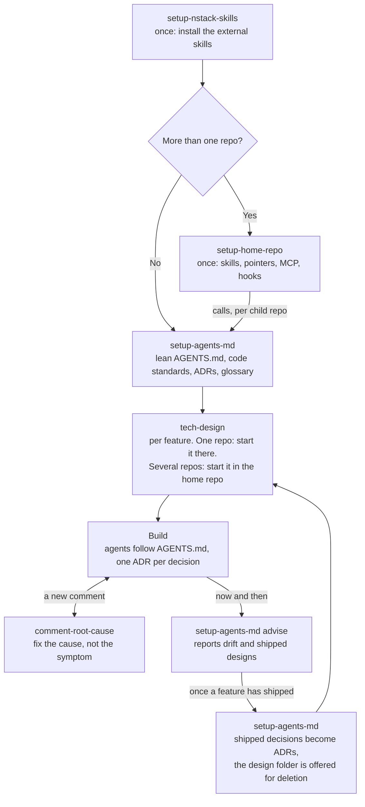

# nstack

The agent skills I use every day, cleaned up so anyone can use them. They work
in Claude Code, Codex, Cursor, and GitHub Copilot.

## Skills

| Skill | Say | What it does |
|---|---|---|
| `tech-design` | "tech design" | Charts a technical design as a shared map, finds every gap, and closes them one per session until a developer or an agent can build from it without guessing. |
| `setup-home-repo` | "set up a home repo" | Creates, updates, audits, and cleans up one repo that holds your shared skills, steering files, MCP servers, and hooks. Local only or git, and how it hands over to `setup-agents-md`: [README](skills/setup-home-repo/README.md). |
| `setup-agents-md` | "set up AGENTS.md" | Creates, trims, and audits a repo's `AGENTS.md`, keeps only what the code cannot say, and puts decisions (ADRs) and the glossary in the repo they belong to. What goes in the docs and what does not: [README](skills/setup-agents-md/README.md). |
| `setup-nstack-skills` | "set up nstack" | Installs the external skills nstack calls, at pinned commits, after you approve the plan. Offers the optional hooks, such as the `comment-root-cause` hook. |
| `comment-root-cause` | "find the root cause" | Fix the root cause, don't comment it. A comment that excuses a workaround becomes a fixed root cause. A comment that explains the code becomes clearer code. Only a fact outside our code may stay, with its source. Also cleans up old comments: `/comment-root-cause <path>`. The agent can start it by itself. An optional hook blocks a new comment with no source until the agent fixes it: [README](skills/comment-root-cause/README.md). |

## How they work together



A design from start to shipped:

1. `/tech-design new <name>` charts the design and lists its gaps.
2. `/tech-design <name>` closes one gap per session.
3. `/tech-design <name> ready` runs the gate and writes the tickets.
4. `/tech-design <name> committed` records the sign-off. Builders start.
5. After the feature ships, `/setup-agents-md` in the repo that holds the
   design asks if it shipped, turns its decisions into ADRs, and offers to
   delete the folder.

- **Each skill works alone.** A skill calls another only when it is installed.
- **Who owns what.** `setup-home-repo` owns the home repo and the one line in
  each child repo that points home. `setup-agents-md` owns the rest of a repo's
  `AGENTS.md`, its ADRs, and its glossary. `tech-design` owns `docs/design/`.
- **One branch per repo.** The two setup skills put every change to a repo on
  one local branch, after you approve the plan. You review and push it.
  `tech-design` writes only its design folder and commits nothing. You commit
  it.
- **`AGENTS.md` by default.** Claude Code reads it from version 2.1.277. A
  `CLAUDE.md` is written only when you ask for one, use an older Claude Code,
  or another `CLAUDE.md` hides `AGENTS.md`. Then it is one line: `@AGENTS.md`.

The details are in the READMEs of
[setup-home-repo](skills/setup-home-repo/README.md) and
[setup-agents-md](skills/setup-agents-md/README.md).

Some skills call skills that live in other repos. Run `setup-nstack-skills` to
install them. The list is in
[external-skills.md](skills/setup-nstack-skills/external-skills.md):

- `tech-design` uses `grilling`, `domain-modeling`, `research`,
  `codebase-design`, `writing-for-agents`, `deslop`, `technical-writing`, and
  `unslop`.

## Install

```bash
git clone https://github.com/svennijhuis/nstack
cp -R nstack/skills/* ~/.claude/skills/    # Claude Code
cp -R nstack/skills/* ~/.codex/skills/     # Codex
cp -R nstack/skills/* ~/.cursor/skills/    # Cursor
cp -R nstack/skills/* ~/.copilot/skills/   # GitHub Copilot
```

Create the target folder first if it does not exist (`mkdir -p ~/.cursor/skills`).

Then say "set up nstack" to pull in the external skills.

With a home repo, `setup-home-repo` moves the skills from the user folder into
it, after you approve the plan.

## Requirements

- Network access for `setup-nstack-skills`, to fetch external skills at their
  pinned commit.
- A git repo to work in, or a local-only home repo. `tech-design` writes to
  `docs/design/<yyyy-mm-dd>-<name>/` relative to the folder the agent runs in.
  Start the agent in the repo that should hold the design. With a home repo,
  start in the child repo the design is about. When the design spans several
  repos, start in the home repo. Either way its decisions end up as ADRs in
  the repos they change. See [setup-agents-md](skills/setup-agents-md/README.md).

## Make them yours

These are starting points. Edit them. Put personal settings in your
user-level instructions file or in a repo's `AGENTS.md`, so you can update the
skills without losing them.

## License

MIT. See [LICENSE](LICENSE). Each skill's `NOTICE.md` names where its ideas
come from.
