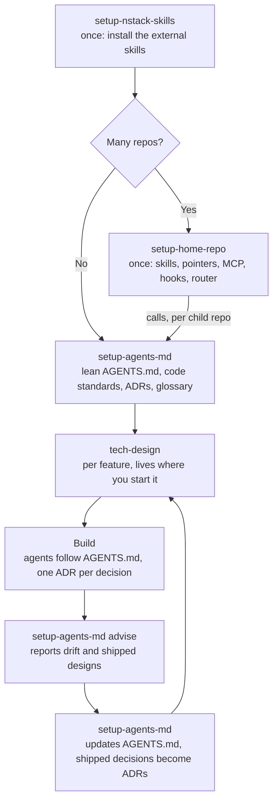

# nstack

The agent skills I use every day, cleaned up so anyone can use them. They work
in Claude Code, Codex, Cursor, and GitHub Copilot.

## Skills

| Skill | Say | What it does |
|---|---|---|
| `tech-design` | "tech design" | Charts a technical design as a shared map, finds every gap, and closes them one per session until a developer or an agent can build from it without guessing. |
| `setup-home-repo` | "set up a home repo" | Creates, updates, audits, and cleans up one repo that holds your shared skills, steering files, MCP servers, and hooks, with a router skill on top. Local only or git, and how it hands over to `setup-agents-md`: [README](skills/setup-home-repo/README.md). |
| `setup-agents-md` | "set up AGENTS.md" | Creates, trims, and audits a repo's `AGENTS.md`, keeps only what the code cannot say, and puts decisions (ADRs) and the glossary in the repo they belong to. What goes in the docs and what does not: [README](skills/setup-agents-md/README.md). |
| `setup-nstack-skills` | "set up nstack" | Installs the external skills nstack calls, at pinned commits, after you approve the plan. |

## How they work together



- **Each skill works alone.** A skill calls another only when it is installed.
- **Who owns what.** `setup-home-repo` owns the home repo and the one line in
  each child repo that points home. `setup-agents-md` owns the rest of a repo's
  `AGENTS.md`, its ADRs, and its glossary. `tech-design` owns `docs/design/`.
- **One branch per repo.** Every change to a repo sits on one local branch. You
  review and push it. Nothing is written before you approve the plan.
- **Only `AGENTS.md`.** No skill writes a `CLAUDE.md`. Claude Code reads
  `AGENTS.md` from version 2.1.277.

The details are in the READMEs of
[setup-home-repo](skills/setup-home-repo/README.md) and
[setup-agents-md](skills/setup-agents-md/README.md).

Some skills call skills that live in other repos. Run `setup-nstack-skills` to
install them. The list is in
[external-skills.md](skills/setup-nstack-skills/external-skills.md):

- `tech-design` uses `grilling`, `domain-modeling`, `research`,
  `codebase-design`, `writing-for-agents`, `deslop`, `technical-writing`, and
  `unslop`.

## Install

```bash
git clone https://github.com/svennijhuis/nstack
cp -R nstack/skills/* ~/.claude/skills/    # Claude Code
cp -R nstack/skills/* ~/.codex/skills/     # Codex
cp -R nstack/skills/* ~/.cursor/skills/    # Cursor
cp -R nstack/skills/* ~/.copilot/skills/   # GitHub Copilot
```

Create the target folder first if it does not exist (`mkdir -p ~/.cursor/skills`).

Then say "set up nstack" to pull in the external skills.

## Requirements

- Network access for `setup-nstack-skills`, to fetch external skills at their
  pinned commit.
- A git repo to work in. `tech-design` writes to
  `docs/design/<yyyy-mm-dd>-<name>/` relative to the folder the agent runs in.
  Start the agent in the repo that should hold the design. With a home repo,
  start in the child repo the design is about. When the design spans several
  repos, start in the home repo. Either way its decisions end up as ADRs in
  the repos they change. See [setup-agents-md](skills/setup-agents-md/README.md).

## Make them yours

These are starting points. Edit them. Put personal settings in your
user-level steering file or in a repo's `AGENTS.md`, so you can update the
skills without losing them.

## License

MIT. See [LICENSE](LICENSE). Each skill's `NOTICE.md` names where its ideas
come from.
