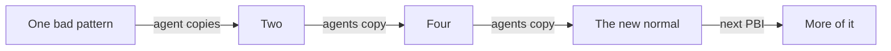
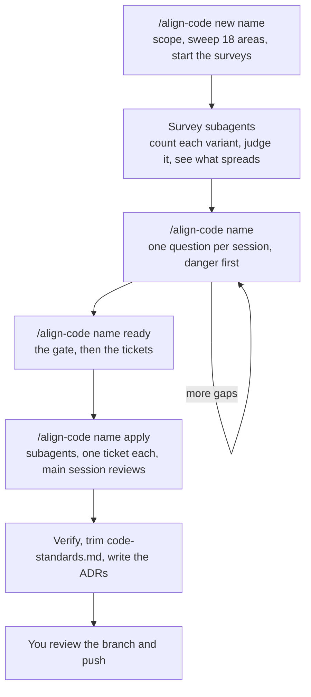

# align-code

Make every part of the code do the same thing the same way, so the code is worth copying and the code itself is the docs. Say "align the code" or type `/align-code`.

1. [Why this skill exists](#1-why-this-skill-exists)
2. [Agents copy code](#2-agents-copy-code)
3. [Why the majority does not win](#3-why-the-majority-does-not-win)
4. [The code is the docs](#4-the-code-is-the-docs)
5. [No breaking changes](#5-no-breaking-changes)
6. [How a run works](#6-how-a-run-works)
7. [Keeping it aligned](#7-keeping-it-aligned)
8. [With the other nstack skills](#8-with-the-other-nstack-skills)

---

## 1. Why this skill exists

Code written with cheap and medium agents works, but it does not agree with itself. One feature throws errors, the next returns null, a third returns a result type. One folder is grouped by feature, the next by layer. Three helpers do the same thing under three names. Every agent made a reasonable choice. Nobody made the same one.

That costs more than looks. A reviewer cannot tell a deliberate choice from an accident. A new developer cannot tell which way is right. And the next agent cannot tell either, so it picks one at random. That is the real problem.

## 2. Agents copy code

An agent that starts a new PBI does not read a style guide first. It reads the code near the change and copies what it sees. That is what it is good at, and it is why it works: the code is the strongest instruction it gets.

So a bad pattern does not stay put. Copy it once and there are two. Two agents copy those and there are four. In no time, most of the code follows the bad standard, and every new change makes it worse. A good pattern spreads the same way, but only if it is the one the agent sees.

This skill breaks that loop. It finds every place the code does one thing in more than one way, lets you choose the way, and rewrites the rest to match. From then on, whatever the agent copies is the right thing.

## 3. Why the majority does not win

The easy rule is "the most common pattern wins". It is wrong here. The most common pattern is often the bad one: it is common because it was copied. So the skill counts each variant, and then judges it against a short list of principles with sources, such as deep modules, errors that are handled once, and input parsed once at the edge. See [principles.md](references/principles.md). You can edit the list.

It also reads the git history and sees which patterns are spreading right now. The questions come in order of danger:

1. **Bad and spreading.** Every day it stays open adds copies.
2. **Bad and the majority.** The next agent copies it first.
3. **Bad.**
4. **Only inconsistent.** Every way works, the code just does it more than one way.

## 4. The code is the docs

The same idea as [setup-agents-md](../setup-agents-md/README.md): a doc that describes the code drifts, and the agent cannot tell which one is true. A code standards file that says "return a Result" helps less than a codebase where every failing call returns a Result. The agent sees the second one without being told.

So at the end of a run, the standards live in:

- **The code.** One way per area, and one exemplar module per area that shows it best.
- **Tools.** Every standard a linter, formatter, or type checker can enforce becomes a rule. A check runs on every change. A doc can only hope to be read.
- **No comments.** The code says what it does. Only a one-line business or decision why, or an outside constraint, stays. A comment that hid a surprise becomes a fix in the code. Agents copy comments too, and a comment drifts like any doc. See [comments.md](references/comments.md).
- **Markers.** Code that cannot change, because a contract freezes it, gets one comment: `Frozen contract: do not copy this shape.` The agent reads that where it would copy from.
- **ADRs.** One per area: what was chosen, why, and what was rejected. The code shows what, never why.

`docs/agents/code-standards.md` is created by `setup-agents-md`, and you maintain it. A run reads it as input. At the end, every line the code now shows is trimmed, after your yes. What is left is only what the code cannot say. Often nothing is left.

## 5. No breaking changes

Alignment changes how the code is written, never what a caller sees. Frozen: API routes and shapes, status codes, events, the database schema, public exports, config names, CLI flags, and the UI, how it looks and what it does. See [contracts.md](references/contracts.md).

An API that does not line up stays as it is. You choose one of:

- **New code only.** The old shape stays, marked frozen. New code follows the standard.
- **An adapter.** The inside follows the standard, a thin layer at the edge keeps the outside the same.

Every ticket must pass the build, the tests, the linter, and a contract check that compares the outside before and after: a schema snapshot for an API, a declaration diff for a package, screenshots for the UI. A missing check is added first, against the unchanged code.

Making the contract itself consistent is a breaking change. That is a versioned API or a migration, and it belongs in `/tech-design`.

## 6. How a run works

It works like Matt Pocock's wayfinder and like `tech-design`: one shared map, small sessions, one decision per session. The end of the map is a plan. Then subagents carry it out.

1. **Chart.** You agree on the scope. The skill sweeps 18 areas, from naming and errors to UI components and tests, and starts one survey subagent per area.
2. **Survey.** Each subagent counts every variant, names an example, sees how many were added in the last 90 days, and judges each one. It changes nothing.
3. **Grill.** One question per session. You see the variants, the counts, the verdicts, the exemplar, the files that would change, and the recommended answer. You choose. When no module is good enough to copy, the skill writes a rough rewrite of one for you to react to.
4. **Ready.** A gate checks that every area has a standard and an exemplar, every change is a ticket, and no ticket can touch a contract. Then it writes the tickets.
5. **Apply.** After your yes, on a local branch. The tickets run in waves: contract checks first, then lint rules, then the exemplars, then the spreading bad patterns, then the rest, then the comments, tests last. Mechanical tickets go to a cheap model, tickets that need judgment to a mid model. The main session reviews every diff and commits one ticket at a time. A ticket that fails twice is set aside, never forced.
6. **Finish.** The surveys run again to prove each area now shows one way. The skill trims `code-standards.md`, writes the ADRs, and gives you the branch. It never pushes.

Every session can stop at any point. The folder `docs/align/<date>-<name>/` holds the whole state.

## 7. Keeping it aligned

Agents keep copying, so alignment needs a guard.

- **`/align-code check`** reads your branch's diff and flags new code that uses a rejected pattern or copies a frozen one. Run it before a pull request.
- **`/align-code advise`** looks at the whole repo, finds drift, and names the file the bad copies came from, so you can fix the source.
- **Lint rules** catch the checkable standards on every change.

## 8. With the other nstack skills

- **`setup-agents-md`** comes first. align-code needs the build, test, and lint commands from `AGENTS.md`. It reads `code-standards.md` and, at the end, trims it after your yes. It never edits `AGENTS.md`: when the standards file is gone, run `/setup-agents-md` and it removes the pointer.
- **`tech-design`** designs new features. Once the code is aligned, its builders copy aligned code. A breaking change to make a contract consistent is a design of its own.
- **External skills.** align-code calls `grilling`, `domain-modeling`, `research`, `codebase-design`, `writing-for-agents`, and `deslop`. Run `/setup-nstack-skills` to install them.
